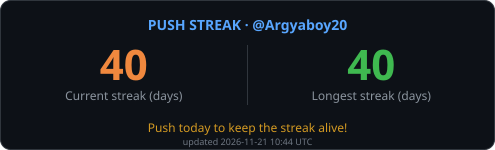

<h1 align="center">Hi, I'm Maulana Farras 👋</h1>

  

---

## 💫 About Me

- 👋 Call me **Farras** or **Ras** - whichever you prefer!
- 👨🏼‍💻 Fullstack Engineer | Mobile Developer
- 👨🏼‍💼 Administration Enthusiast
- 📫 Let's talk - links below 👇

## 🎯 Currently

   

## 🌐 Socials

## 💻 Tech Stack

**Languages** 
      

**Frontend & Mobile** 
       

**Backend & API** 
       

**Database** 
    

**Cloud, Hosting & DevOps** 
     

**Services & APIs** 
     

**Design & Planning** 
 

## 🔥 Push Streak

Consecutive days with at least one contribution (same data as the green squares on my profile). Miss a day → back to zero.

  

## 🐍 Contribution Snake

## 📈 GitHub Metrics

  

## ✍️ Random Dev Quote

---

  

